# Sorriso+

MVP acadêmico com Python/Streamlit na interface e Xano para autenticação, autorização e dados via API REST. Implantação pública prevista em Render ou Railway.

## Estado atual

O projeto possui acesso da equipe, portal do Paciente, recuperação de senha, painéis por perfil, Agenda, cadastros, Consultas, Procedimentos, Exames e consulta de Registros Clínicos. O Profissional aparece na interface como Dentista. O Prontuário completo ainda possui tarefas abertas em `openspec/changes/implementar-prontuario-completo/`; a existência de uma tela não significa que todas as funcionalidades planejadas estejam concluídas.

O export Xano define sessão interna de até oito horas, conforme `AUTH_SESSION_TTL_SECONDS`. No uso local da equipe, `python iniciar_local.py` habilita recuperação automática após recarga, respeitando a validade original do Xano. O portal do Paciente possui sessão própria.

As telas existentes usam a identidade visual Sorriso+ e os mascotes transparentes de `assets/mascotes-tratados/`, com assinatura compartilhada. A navegação exibe somente ações disponíveis para o perfil autenticado; módulos que ainda não possuem fluxo não aparecem como opções. A iconografia vetorial, sua procedência e a revisão de segurança estão documentadas em [Ícones da interface](docs/icones-interface.md).

## Telas e caminhos por usuário

Administrador, Recepcionista e Dentista usam a mesma entrada da equipe. O perfil da **Conta de Acesso**, validado pelo Xano, determina o menu apresentado. Não existem URLs independentes para cada tela do menu: a navegação acontece dentro do Streamlit. O Paciente usa um portal separado.

| Usuário | Entrada local | Caminhos na interface |
|---|---|---|
| Administrador | `http://localhost:8501` · [app.py](app.py) | Login → Visão geral → Agenda, Pacientes, Profissionais, Procedimentos ou Reagendamento. Atalhos: Cadastrar paciente e Cadastrar profissional. |
| Recepcionista | `http://localhost:8501` · [app.py](app.py) | Login → Visão geral → Agenda, Pacientes, Profissionais ou Reagendamento. Atalho: Cadastrar paciente. |
| Dentista / Profissional | `http://localhost:8501` · [app.py](app.py) | Login → Visão geral → Agenda, Prontuários ou Exames. Na Agenda: gerenciar as próprias Consultas e acessar os Procedimentos da Consulta. |
| Paciente | `http://localhost:8503` · [portal_paciente.py](portal_paciente.py) | Login do portal → Consultas futuras ou passadas, Informações liberadas e Exames. |

Para abrir as duas entradas ao mesmo tempo, configure `XANO_API_BASE_URL` nos dois terminais e execute:

```sh
# Terminal 1 — equipe, com recuperação local automática da sessão
python iniciar_local.py

# Terminal 2 — portal do Paciente
python -m streamlit run portal_paciente.py --server.port=8503
```

A porta `8502` é usada pela recuperação de sessão da equipe. As portas acima descrevem a execução local; não são endereços públicos de implantação.

### Entrada da equipe

Administrador, Recepcionista e Dentista informam o e-mail e a senha da própria Conta de Acesso. A opção **Esqueci minha senha** conduz à recuperação por código, quando o serviço Xano/SendGrid está configurado.

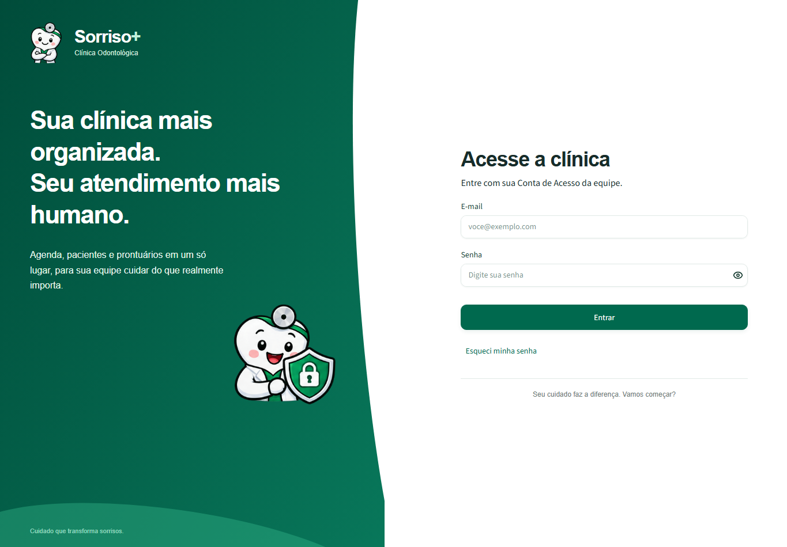

### Administrador

O painel reúne o resumo administrativo e os atalhos de cadastro. Para agendar: **Agenda → Nova Consulta → selecionar Paciente, Profissional e horário → confirmar**. Para editar um cadastro: **Pacientes → Editar → Salvar alterações**.

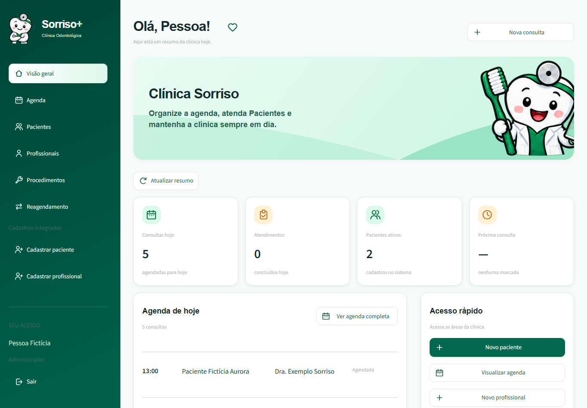

### Recepcionista

O caminho de atendimento é **Visão geral → Agenda → Nova Consulta**. Cadastros ficam em **Pacientes → Cadastrar paciente** e mudanças de horário em **Reagendamento**. O perfil não recebe os menus clínicos de Prontuários e Exames nem o cadastro de Profissional.

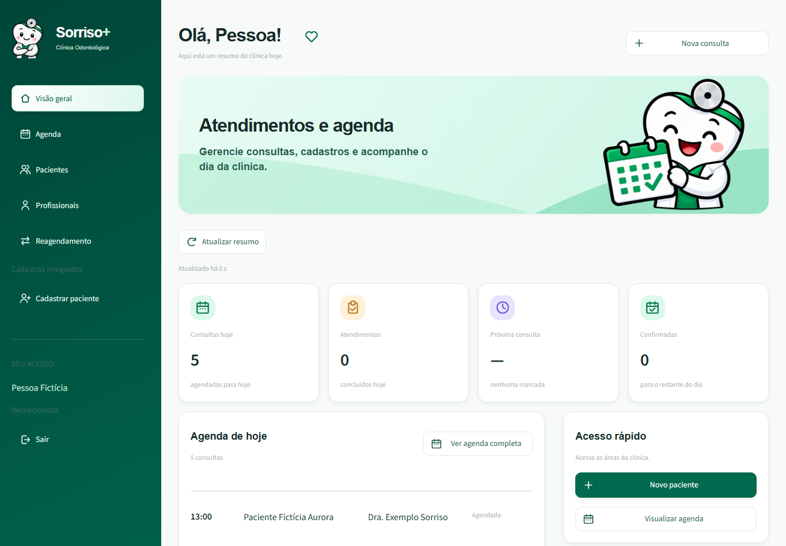

### Dentista / Profissional

Para acompanhar atendimentos: **Visão geral → Agenda → Gerenciar consultas e horários**. Para registrar evolução: **Prontuários → Nova Evolução → selecionar Paciente e Consulta → informar evolução → Salvar no prontuário**. Para solicitar um Exame: **Exames → formulário de solicitação → selecionar Paciente e Consulta → preencher tipo e data → solicitar**.

A solicitação do Exame é registrada para o Paciente e a Consulta selecionados. Ela não envia automaticamente pedidos a laboratório ou a profissional externo. As seções completas de Prontuário, documentos e odontograma permanecem sujeitas às pendências da change indicada acima.

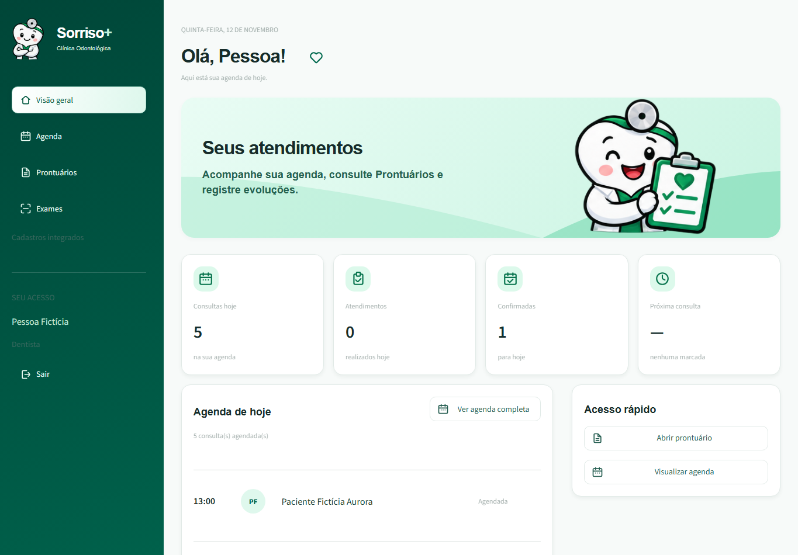

### Paciente

O Paciente entra no portal próprio e alterna entre **Consultas**, **Informações liberadas** e **Exames**. Em Consultas, pode selecionar **Futuras** ou **Passadas**. O agendamento é feito pela equipe; para cancelar uma Consulta, o Paciente entra em contato com a clínica. Resultados e informações clínicas aparecem conforme liberação e autorização do Xano.

Cadastrar um Paciente pela equipe cria o cadastro da pessoa atendida e seu Prontuário; isso não cria automaticamente uma Conta de Acesso para entrar no portal.

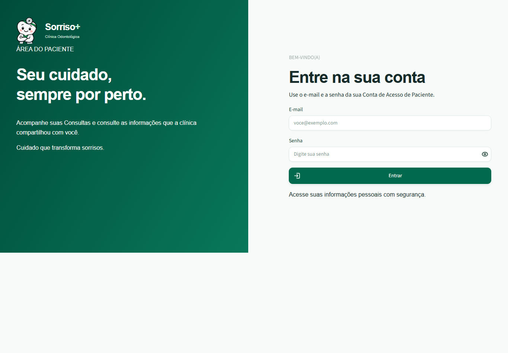

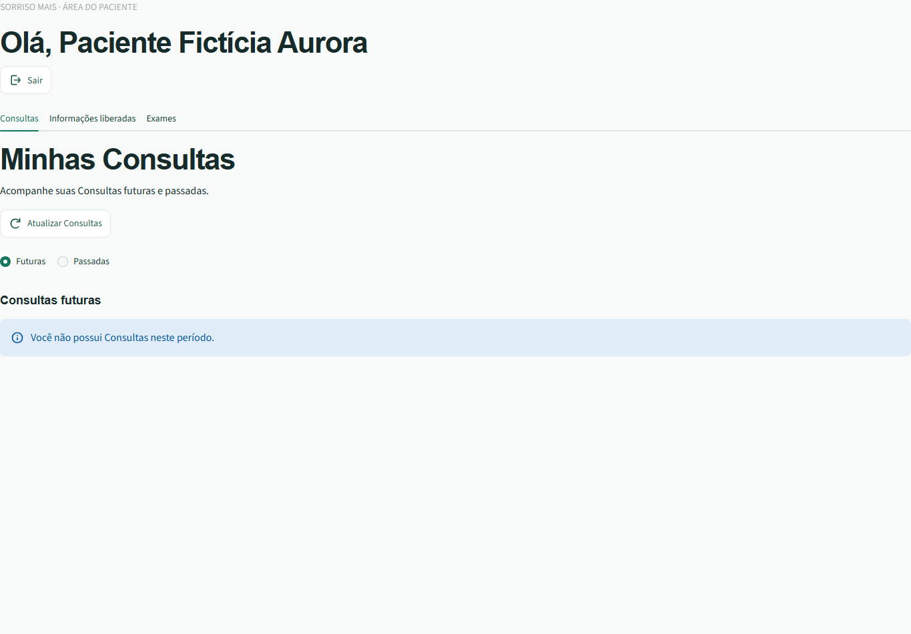

### Demais telas

<details>
<summary>Agenda e Nova Consulta</summary>

**Caminho:** menu Agenda; para agendar, ação Nova Consulta disponível à equipe administrativa autorizada.

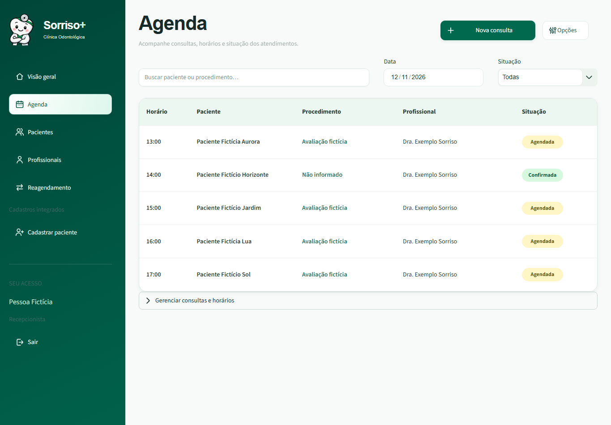

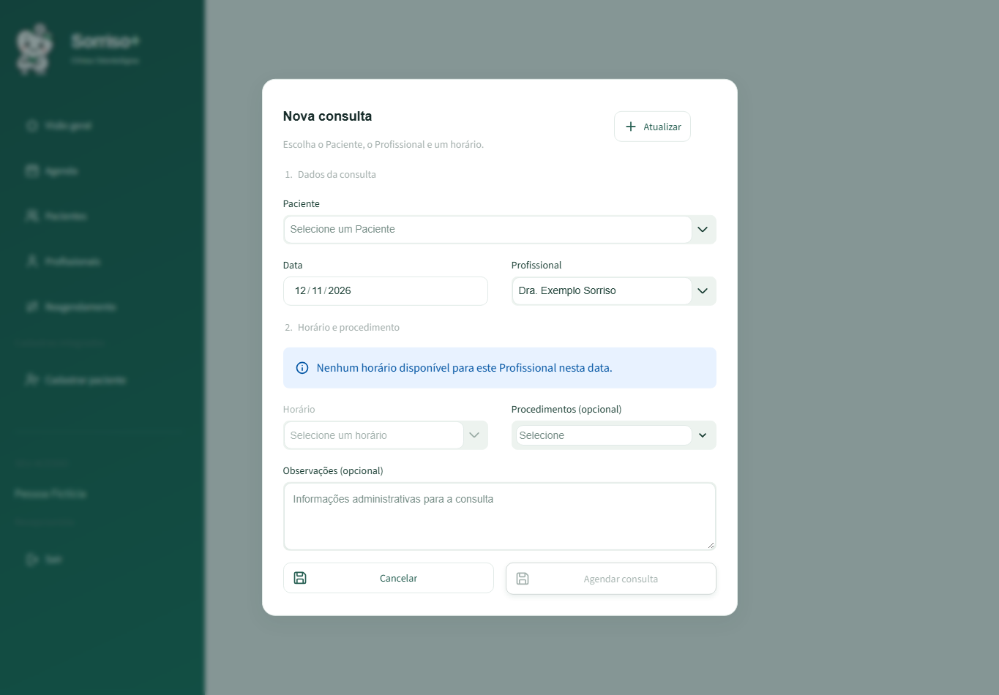

</details>

<details>
<summary>Pacientes e cadastro de Paciente</summary>

**Caminho:** menu Pacientes → Editar; para novo cadastro, Cadastrar paciente.

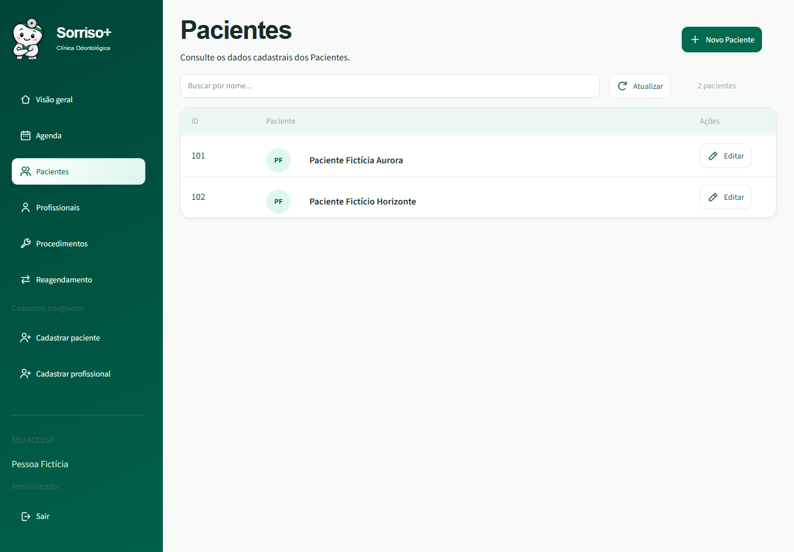

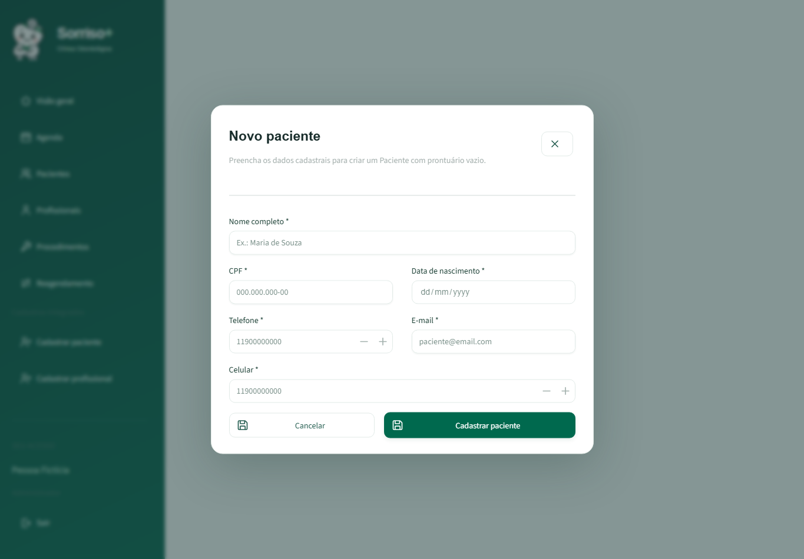

</details>

<details>
<summary>Profissionais e cadastro de Profissional</summary>

**Caminho:** menu Profissionais. O cadastro de Profissional é exclusivo do Administrador, pela ação Cadastrar profissional.

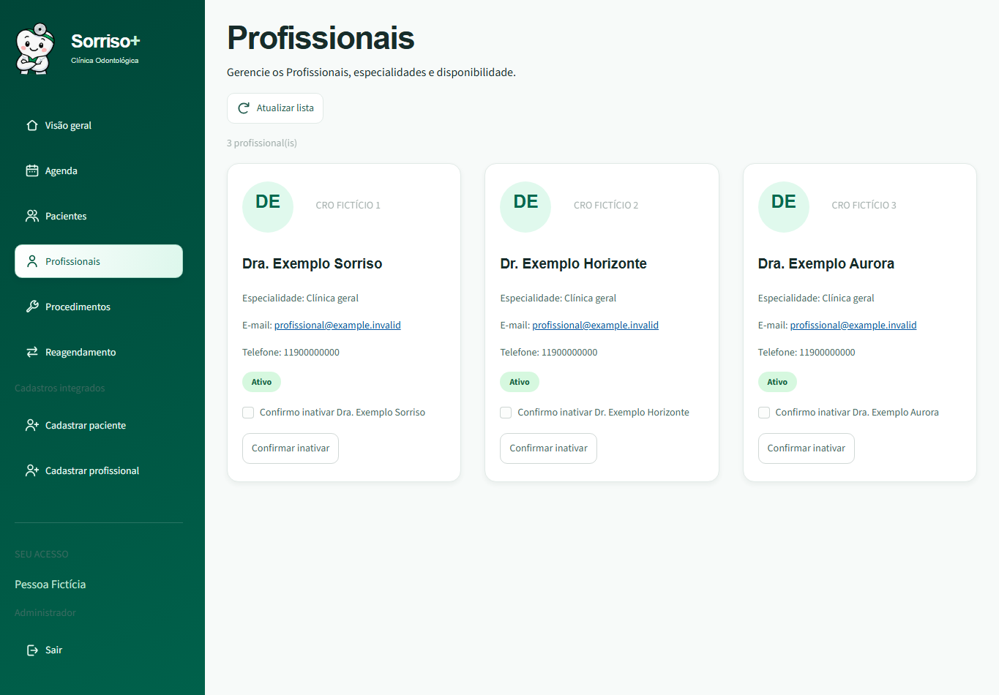

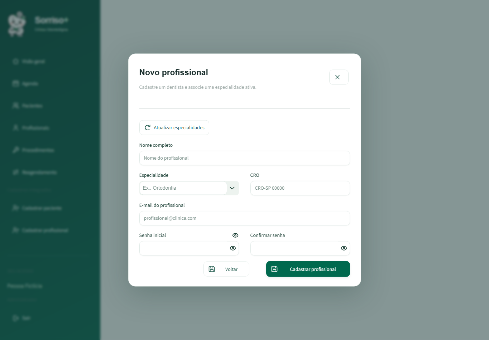

</details>

<details>
<summary>Procedimentos, Prontuários e Exames</summary>

**Caminhos:** Administrador → Procedimentos; Dentista → Prontuários; Dentista → Exames.

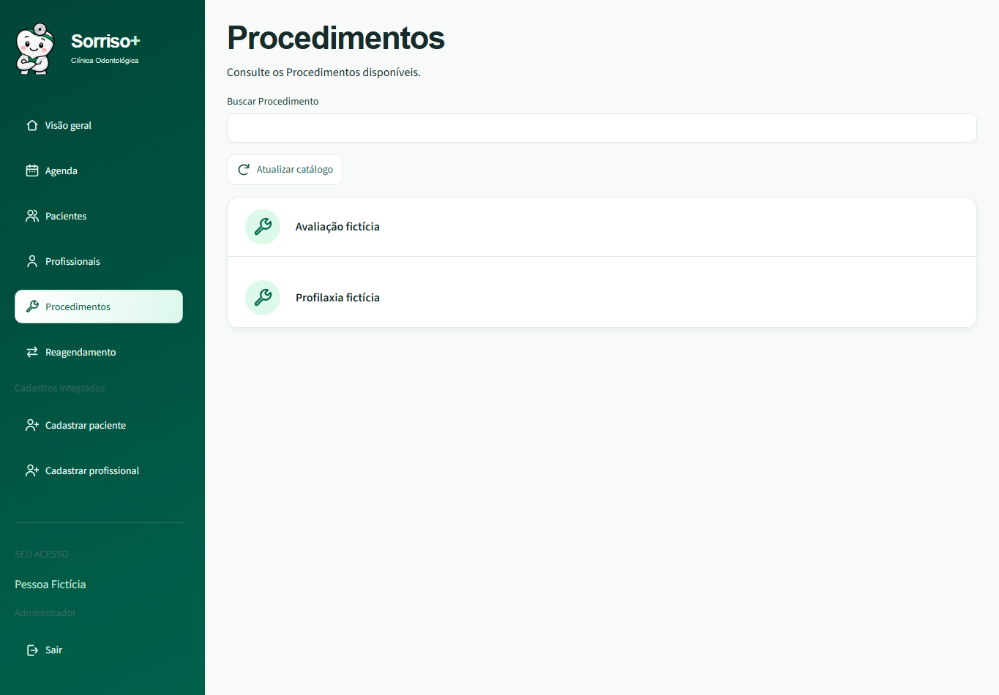

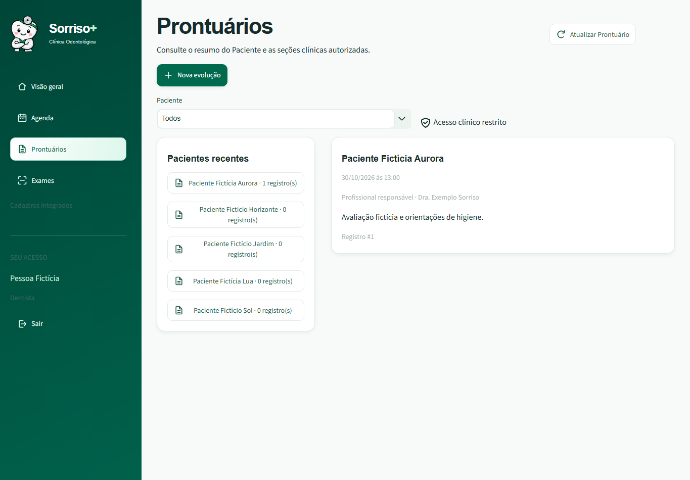

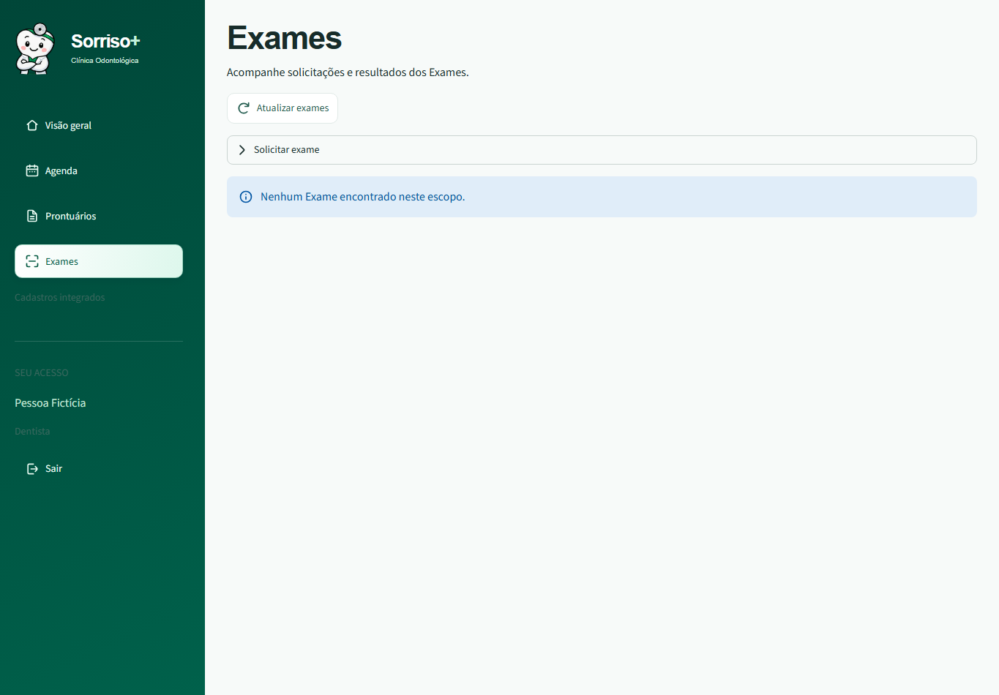

</details>

As capturas desta seção mostram componentes reais da interface renderizados com o cliente visual de `tests/visual/app_referencias.py`, dados inteiramente fictícios e respostas simuladas, sem chamadas ao Xano. Foram capturadas em 12/11/2026, em resolução de 1365 × 950, com altura expandida quando necessário. São exemplos visuais, não comprovação de integração publicada. As permissões efetivas continuam sendo verificadas pelo Xano.

## Executar localmente

Use Python 3.10 ou superior. Execute os comandos a partir da raiz do repositório. Crie um ambiente virtual local, instale as dependências de desenvolvimento e configure a URL HTTPS do grupo de API do Xano.

### macOS (Terminal, zsh ou bash)

```sh
python3 -m venv .venv
.venv/bin/python -m pip install -r requirements-dev.txt
export XANO_API_BASE_URL="https://sua-instancia.xano.io/api:seu-grupo"
export XANO_HTTP_TIMEOUT_SECONDS="10"
.venv/bin/python -m streamlit run app.py
```

### Windows (PowerShell)

Se o ambiente virtual já estiver instalado, inicie com:

```powershell
.\iniciar.cmd
```

O script usa a URL pública do grupo Xano documentada abaixo quando
`XANO_API_BASE_URL` não está definida, sem gravar credenciais ou alterar
configurações permanentes do Windows. Valores já definidos no ambiente são
preservados. Para outra porta, defina `$env:STREAMLIT_SERVER_PORT = "8510"`
antes de executar o script e abra `http://localhost:8510`.
O processo precisa de acesso à rede para consultar o Xano;
o script não altera firewall ou permissões de execução.

Para instalar o ambiente ou iniciar manualmente:

```powershell
py -3 -m venv .venv
.venv\Scripts\python.exe -m pip install -r requirements-dev.txt
$env:XANO_API_BASE_URL = "https://sua-instancia.xano.io/api:seu-grupo"
$env:XANO_HTTP_TIMEOUT_SECONDS = "10"
.venv\Scripts\python.exe -m streamlit run app.py
```

Abra **http://localhost:8501**. Substitua o endereço ilustrativo pela URL HTTPS do grupo publicado. Para executar sem ferramentas de teste, instale `requirements.txt`.

O grupo validado nesta entrega é `https://x8ki-letl-twmt.n7.xano.io/api:sorriso-acesso:v1`. Cada terminal novo precisa receber `XANO_API_BASE_URL` antes de iniciar o Streamlit. Os comandos acima configuram a variável somente no terminal atual.

O arquivo `.env.example` é uma referência: a aplicação não carrega `.env` automaticamente. Credenciais administrativas do Xano não são credenciais de login e não devem ser usadas no frontend.

| Variável | Ambiente | Configuração |
|---|---|---|
| `XANO_API_BASE_URL` | Streamlit | Obrigatória; HTTPS, sem credenciais, query string ou fragmento |
| `XANO_HTTP_TIMEOUT_SECONDS` | Streamlit | Opcional; número positivo e finito, padrão 10 segundos |
| `XANO_CADASTRO_PACIENTE_HABILITADO` | Streamlit | Opcional; habilitado por padrão após publicação e validação do endpoint; definir `0` para ocultar a ação |
| `SORRISOMAIS_MODO_DEMONSTRACAO` | Streamlit | Opcional; padrão `0`; definir `1` para habilitar telas com dados fictícios limitados à sessão. O login continua usando Xano |
| `AUTH_SESSION_TTL_SECONDS` | Xano | O export usa padrão e limite máximo de 28800 segundos; configure o mesmo valor na instância para aplicar oito horas |

Sem configuração válida, a tela informa o problema e desabilita o formulário.

Na entrega inicial do modo Xano, estavam disponíveis login, identificação e logout,
cadastro de Paciente, cadastro de Profissional e listagem de Especialidades
necessária ao cadastro. Agenda, Consultas, listagens e perfil de Paciente,
Prontuários e Registros Clínicos ainda não tinham integração Xano confirmada.
Esse registro é histórico: os módulos e caminhos atuais estão descritos na
seção **Telas e caminhos por usuário** acima; pendências do Prontuário completo
continuam registradas na change correspondente.

O export local de `GET /registros-clinicos` também inclui retificações
append-only com conteúdo, justificativa, autoria e data. Essa alteração ainda
não havia sido publicada nem validada no grupo Xano na entrega inicial.
As capturas atuais demonstram a interface com respostas simuladas e não
substituem a validação das rotas no ambiente publicado.

### Prontuário e Nova Evolução — finalização local

Na branch `prontuario-registros-clinicos-xano`, Nova Evolução inicia com o
Paciente filtrado no Prontuário quando ele está no escopo das Consultas.
Trocar o Paciente atualiza as opções de Consulta e descarta o texto anterior,
evitando associá-lo ao Prontuário errado. Cancelar, fechar, salvar com sucesso
ou encerrar a sessão limpa o rascunho. Falhas recuperáveis preservam o texto
e não repetem o POST automaticamente. HTTP 401 remove o formulário e impede
que o histórico já carregado seja reapresentado. O formulário usa a largura
da área principal, sem ficar restrito à coluna estreita de ações.

Verificação local em 29/10/2026: **286 testes Python e 7 subtestes passaram**,
incluindo AppTests das duas telas, autenticação/sessão, interface, cache,
roteamento e contratos REST. **7 testes JavaScript dos contratos clínicos
passaram**, e `openspec validate prontuario-registros-clinicos-xano --strict`
validou a change. Os cenários novos foram reproduzidos com falha antes da
correção. Os testes usam dados fictícios e substituem a rede.

**Validação real pendente:** nenhuma chamada ao Xano foi executada nesta
finalização. Há configuração da Metadata API, mas não há sessões clínicas
fictícias autenticadas de Profissional, Paciente e Recepcionista disponíveis
para validar autorização, criação, histórico e retificação no grupo publicado.
O token administrativo não substitui a autenticação desses perfis. A tarefa
2.3 permanece aberta; a change não está pronta para aprovação clínica ou
arquivamento. A inspeção visual em navegador e em celular também não foi
executada nesta finalização; os estados foram verificados com AppTest.

Na branch `feat/3-retomada-cadastro-profissional`, os métodos clientes e os
testes unitários locais dos contratos propostos para Disponibilidades, Consultas
e Registros Clínicos foram iniciados conforme a change
`agenda-consultas-registros-clinicos-api`. Isso não significa que as rotas estejam
publicadas ou validadas no Xano. A criação das tabelas e endpoints, autorização,
transações, concorrência e isolamento clínico ainda dependem de verificação em
um workspace de teste do Xano.

Para respeitar o limite de requisições do workspace, a Conta de Acesso é
revalidada no máximo uma vez a cada 20 segundos durante reruns da interface.
O Xano continua validando cada operação protegida. A lista de Especialidades
fica no estado da sessão por 5 minutos; depois de erro, uma nova tentativa
aguarda 20 segundos. Nenhum desses caches é compartilhado entre sessões.

## Estrutura e contrato

- `app.py` e `assets/`: interface e identidade visual.
- `sorrisomais/config.py`: configuração.
- `sorrisomais/api.py`: chamadas REST e validação de respostas.
- `sorrisomais/sessao.py`: entrada, revalidação e saída.
- `backend/xano/`: Conta de Acesso, Sessão de Acesso, validação e endpoints.

| Rota relativa à URL base | Entrada | Sucesso |
|---|---|---|
| `POST /auth/login` | JSON com `email` e `senha` | 200 com `token`, `tipo_token` e `expira_em` |
| `GET /auth/me` | Bearer token | 200 com `conta` e `expira_em` |
| `POST /auth/logout` | Bearer token | 204 sem corpo |
| `GET /especialidades` | Bearer token de Administrador | 200 com especialidades ativas |
| `POST /profissionais` | Bearer token de Administrador e JSON estrito | 201 com Profissional e Conta de Acesso vinculados |
| `GET /disponibilidades` | Bearer token e filtros opcionais de Profissional/período | 200 com Disponibilidades livres autorizadas |
| `POST /disponibilidades` | Bearer token e dados de Profissional/início/fim | 201 com Disponibilidade criada |
| `PATCH /disponibilidades/{id}` | Bearer token e intervalo ou situação | 200 com Disponibilidade atualizada |
| `POST /consultas` | Bearer token, Paciente, Disponibilidade e Procedimentos opcionais | 201 com Consulta agendada |
| `GET /consultas` | Bearer token e filtros opcionais por Paciente/Profissional/período/situação | 200 com Consultas no escopo autorizado |
| `PATCH /consultas/{id}/situacao` | Bearer token, nova situação e motivo quando exigido | 200 com Consulta atualizada |

O cadastro de Profissional exige `nome`, `email`, `senha`, `cro` e `especialidade_id`. A confirmação da senha é validada somente na interface e não é enviada. O backend normaliza e-mail e CRO, exige uma especialidade ativa e define o único perfil da nova Conta de Acesso como `profissional`. A resposta não contém senha, e-mail, hash ou token. A autorização é verificada no Xano em cada chamada.

Erros esperados no cadastro: 400 para dados inválidos, 401 para sessão inválida, 403 para acesso não autorizado, 409 para e-mail ou CRO duplicado e 429 para limite de requisições. Timeout, erro 5xx ou resposta incompatível são tratados como resultado não confirmado; o cliente não repete automaticamente a operação. Consulte a [especificação de cadastro de Profissional](openspec/specs/cadastro-profissional/spec.md) para os requisitos e cenários do fluxo.

Na verificação local das rotas de Consultas e Disponibilidades, passaram 28 testes Python (`PYTHONPATH=. pytest tests/api_contracts/test_consultas_get.py tests/api_contracts/test_consultas_post.py tests/api_contracts/test_disponibilidades_get.py tests/api_contracts/test_disponibilidades_post.py tests/api_contracts/test_disponibilidades_patch.py tests/api_contracts/test_consultas_situacao_patch.py`) e 7 testes JavaScript (`node --test tests/js/api_contracts/consultas-get.test.mjs tests/js/api_contracts/consultas-post.test.mjs tests/js/api_contracts/disponibilidades-get.test.mjs tests/js/api_contracts/disponibilidades-post.test.mjs tests/js/api_contracts/disponibilidades-patch.test.mjs tests/js/api_contracts/consultas-situacao-patch.test.mjs`). Os testes unitários usam clientes simulados e não acessam a rede. O smoke público autenticado de `GET /consultas` e `GET /disponibilidades` retornou 200; sem credencial, ambas responderam 401. Não foi feita inspeção via Metadata API, portanto esses resultados não confirmam a configuração interna completa do Xano.

O [design](openspec/changes/archive/2026-09-25-login-streamlit-xano/design.md) detalha o contrato e as permissões. As tabelas legadas e APIs de outras funcionalidades foram preservadas.

O token fica no estado da sessão Streamlit. A identidade é revalidada antes da exibição protegida. O export Xano limita o prazo absoluto a oito horas, sem renovação, e `auth/me` devolve a validade emitida pelo backend. A instância publicada ainda precisa receber `AUTH_SESSION_TTL_SECONDS=28800` para aplicar esse padrão. O logout sempre limpa o estado local e informa quando não confirmou a revogação remota.

Para uso apenas local, execute `python iniciar_local.py` e acesse `http://localhost:8501`. Após login, o aplicativo mantém o acesso automaticamente: uma navegação breve em localhost grava o cookie e retorna à tela. A sessão poderá ser recuperada após atualizar a página, com nova validação no Xano. Use sempre `localhost`; `127.0.0.1` é outro host para cookies. As portas 8501 e 8502 precisam estar livres.

A recuperação local usa cookie HttpOnly, SameSite=Strict e identificador aleatório. O token permanece na memória do processo; nenhuma credencial é gravada em arquivo ou localStorage. O cookie usa HTTP local, sem Secure. A recuperação termina no logout, na expiração original ou ao encerrar o aplicativo. Essa opção não é destinada a hospedagem remota. A execução direta com `streamlit run app.py` mantém o comportamento sem persistência após recarga.

## Testar

Os comandos abaixo usam diretamente o Python do ambiente virtual e funcionam sem ativar o ambiente. No Windows, use `.venv\Scripts\python.exe` no lugar de `.venv/bin/python`.

Para navegar pelas telas demonstrativas, defina `SORRISOMAIS_MODO_DEMONSTRACAO=1`. É necessário autenticar no Xano; os dados demonstrativos não são gravados no backend e desaparecem ao encerrar a sessão.

```sh
.venv/bin/python -m pytest tests/test_acesso.py tests/test_interface.py -q
openspec validate --all --strict
```

Cada rota REST `GET` ou `POST` possui testes unitários separados em Python
(`tests/api_contracts/`) e JavaScript (`tests/js/api_contracts/`). Execute-os
sem rede com:

```sh
.venv/bin/python -B -m pytest tests/api_contracts -q -p no:cacheprovider
node --test tests/js/api_contracts/auth-login.test.mjs tests/js/api_contracts/auth-me.test.mjs tests/js/api_contracts/auth-logout.test.mjs tests/js/api_contracts/pacientes-post.test.mjs tests/js/api_contracts/profissionais-post.test.mjs tests/js/api_contracts/especialidades-get.test.mjs tests/js/api_contracts/client-options.test.mjs
```

Em 23/09/2026, **54 testes locais e 25 testes reais passaram**. Os testes locais verificam configuração, contrato, falhas de rede, erros seguros e comportamento da interface. A suíte real verifica diretamente no Xano campos, perfis, contas bloqueadas/inativas, identidade própria, revogação, replay, logout repetido, perda de acesso, sessões independentes e expiração efetiva.

Para repetir os testes reais, configure `XANO_API_BASE_URL`, `XANO_METADATA_BASE_URL`, `XANO_WORKSPACE_ID` e `XANO_METADATA_TOKEN` no ambiente. O token administrativo deve vir de uma fonte segura e nunca ser salvo no repositório.

Para inspeção de tabelas, schemas e demais chamadas da Metadata API, use `XANO_METADATA_BASE_URL=https://x8ki-letl-twmt.n7.xano.io/api:meta` com `Authorization: Bearer` usando `XANO_METADATA_TOKEN`. Acrescente `/workspace/{XANO_WORKSPACE_ID}` para operações do workspace. Não derive esse endereço de `XANO_API_BASE_URL`, que aponta exclusivamente para o grupo de API do projeto. Skills e ferramentas de inspeção devem seguir essa mesma separação.

```sh
XANO_TESTAR_REAL=1 .venv/bin/python -m pytest tests/test_xano_real.py -q --tb=short
```

No PowerShell:

```powershell
$env:XANO_TESTAR_REAL = "1"
.venv\Scripts\python.exe -m pytest tests/test_xano_real.py -q --tb=short
```

Sem a opção explícita, os testes reais são ignorados. A suíte cria somente contas fictícias, com senhas aleatórias transformadas pelo campo password do Xano, e as inativa ao terminar. O teste de expiração cria um grupo temporário com validade de oito segundos e o remove em `finally`; a validação do grupo principal espera o limite de oito horas e só deve ser executada depois de configurar a instância com `AUTH_SESSION_TTL_SECONDS=28800`. Nenhuma verificação depende de ignorar o prazo ou alterar o relógio.

As chamadas da suíte são espaçadas para respeitar o limite do plano Xano. HTTP 429 pode prolongar a execução. A aplicação não repete automaticamente login ou logout.

Também foram verificados: computador (1440 px), tablet (768 px), celular (390 px), ausência de rolagem horizontal, foco de teclado, senha mascarada, uma única chamada após clique duplo e bloqueio do formulário durante o envio. O fluxo completo navegador → Streamlit → Xano foi confirmado com entrada, identidade e saída.

Os três endpoints usam `history = false`; o histórico do grupo permaneceu vazio após os testes. Evidências locais sem credenciais ficam em `test-results/`, ignorado pelo Git.

## Acesso administrativo fictício

O login é feito com uma Conta de Acesso ativa cujo perfil foi autorizado no Xano. Para testar como Administrador em outra máquina, solicite ao responsável pelo workspace uma conta administrativa fictícia individual ou o provisionamento de uma conta de teste. O responsável deve entregar os dados de acesso por um canal seguro; não reutilize senha pessoal, não a coloque em `.env`, arquivos do projeto, capturas de tela ou no Git. Digite a senha diretamente no formulário de login.

Arquivos de credenciais locais de outra máquina não são necessários e não devem ser copiados. A autorização continua sendo verificada pelo Xano: a interface apresenta as ações administrativas somente quando a Conta de Acesso autenticada retorna o perfil Administrador. Sem uma conta fictícia ativa e autorizada no Xano, é possível iniciar o app, mas não concluir o login administrativo.

## Documentação

### Cadastro de Paciente — funcionando e pronto

O fluxo está publicado e funcionando no Xano para Administrador e Recepcionista. A integração real foi aprovada em 62 testes no grupo temporário; criação e reenvio idempotente foram confirmados no endpoint publicado. A interface também foi verificada no navegador para os dois perfis em computador, tablet e celular, com navegação por teclado. O cadastro cria um Paciente e seu Prontuário; não cria Conta de Acesso para o Paciente. Use somente dados fictícios.

### Cadastro de pacientes — detalhes da implementação

O endpoint de cadastro foi publicado e validado no Xano em 27/09/2026. **Cadastrar paciente** fica disponível por padrão para Administrador e Recepcionista autenticados. Para ocultar a ação em uma implantação, defina `XANO_CADASTRO_PACIENTE_HABILITADO=0` antes de iniciar o Streamlit. Essa opção controla apenas a interface; a autorização efetiva é aplicada no endpoint.

- **Nome completo \***: obrigatório, de 2 a 120 caracteres após remover espaços externos.
- **Data de nascimento \***: obrigatória, data real até hoje em `America/Sao_Paulo`.
- **Telefone \***: obrigatório, com 10 ou 11 dígitos nacionais após normalizar espaços, parênteses e hífen.
- **CPF \***: obrigatório, com formato e dígitos verificadores válidos; persistido sem máscara.
- **E-mail \*** e **Celular \***: obrigatórios, normalizados e validados. Familiares podem compartilhar contato.

O formulário não solicita senha nem cria login do Paciente. **Cadastrar** envia uma operação; **Voltar** limpa o formulário. Sucesso limpa os campos e preserva a sessão da equipe. Rejeição por dados inválidos ou CPF duplicado preserva os campos e permite correção. Após resultado incerto, **Reenviar mesma operação** utiliza a mesma chave e os mesmos dados; não há repetição automática. Sair ou voltar não desfaz um cadastro possivelmente concluído, e perder a sessão perde a chave local: conferir o resultado antes de abrir outra operação.

Contrato publicado: `POST /pacientes`, Bearer token, JSON com `nome`, `data_nascimento` em `YYYY-MM-DD`, `telefone`, `cpf`, `email`, `celular` (todos obrigatórios) e `operacao_id` UUID v4. Resposta 201: `{"paciente":{"id":123,"nome":"Paciente Fictício","situacao":"ativo"},"operacao_id":"mesmo-UUID-enviado"}`. Erros esperados: 400, 401, 403, 409 com `CPF_DUPLICADO` ou `OPERACAO_CONFLITANTE`, 429 e indisponibilidade. Mensagens recebidas do servidor não são exibidas diretamente.

**Verificado no Xano em 27/09/2026:** índice único de CPF e campos `situacao` e `atualizado_em` na tabela Paciente, após auditoria que encontrou a tabela vazia. A validação de CPF e nascimento do endpoint versionado passou em 26 testes reais, usando grupo temporário autenticado sem gravar Pacientes. O schema está em `backend/xano/table/paciente.xs`.

**Cadastro de Paciente:** endpoint `POST /pacientes` publicado no grupo principal do Xano em 27/09/2026. A integração real completa passou em 62 testes no grupo temporário; o smoke test do endpoint publicado confirmou criação e replay idempotente. O fluxo visual foi verificado no Chrome para Administrador e Recepcionista em computador, tablet e celular, incluindo teclado e ausência de rolagem horizontal. Contas e Pacientes de teste foram inativados, e o grupo temporário removido. Capturas fictícias estão em `test-results/cadastro-paciente/` (ignorado pelo Git).

Para repetir apenas a verificação real de CPF, nascimento e schema, configure as mesmas quatro variáveis administrativas descritas na seção de testes e execute:

```powershell
$env:XANO_TESTAR_PACIENTE = "1"
.venv\Scripts\python.exe -B -m pytest tests/test_xano_pacientes_real.py -q --tb=short
```

No macOS, execute `XANO_TESTAR_PACIENTE=1 .venv/bin/python -B -m pytest tests/test_xano_pacientes_real.py -q --tb=short`.

A suíte compila o trecho de validação em grupo temporário, remove esse grupo ao terminar e inativa a Conta de Acesso fictícia criada para os testes. Não cria Pacientes nem Prontuários. Sem a flag, os testes são ignorados.

#### Idempotência e integração completa

O comprovante guarda SHA-256 do payload normalizado, sem persistir uma cópia dos campos pessoais e sem exigir configuração de chave. Essa escolha foi feita para o projeto acadêmico com dados exclusivamente fictícios. Hash sem chave não protege dados reais contra tentativa de adivinhação; não use este desenho com dados reais. A tabela `cadastro_paciente_operacao` possui índice único por Conta de Acesso e UUID. O endpoint grava Paciente, Prontuário e comprovante na mesma transação e reconsulta o resultado confirmado após uma disputa.

Essa suíte publica o endpoint completo em um grupo temporário, junto de operações auxiliares protegidas para contagens, expiração e falha de gravação. A falha é fixa no código de teste e não acrescenta parâmetros ao endpoint principal. Os testes de sucesso criam somente dados fictícios: ao terminar, Pacientes e Contas de Acesso criados pela suíte são inativados; Prontuários e comprovantes são preservados. O grupo temporário é removido. Não apagar históricos para limpar testes.

Em 27/09/2026, passaram 62 testes reais da integração temporária e o smoke test de `POST /pacientes` no grupo principal (criação e replay). A regressão local teve 196 testes aprovados. A suíte de integração é opt-in. O teste em produção cria um Paciente e uma Conta fictícios, inativa ambos ao terminar e preserva Prontuário e comprovante.

Execute a integração completa no Xano com dados fictícios:

```powershell
$env:XANO_TESTAR_PACIENTE_INTEGRACAO = "1"
.venv\Scripts\python.exe -B -m pytest tests/test_xano_pacientes_integracao.py -q --tb=short
```

No macOS, execute `XANO_TESTAR_PACIENTE_INTEGRACAO=1 .venv/bin/python -B -m pytest tests/test_xano_pacientes_integracao.py -q --tb=short`.

```powershell
.venv\Scripts\python.exe -B -m pytest tests/test_acesso.py tests/test_interface.py tests/test_profissionais.py tests/test_pacientes.py -q -p no:cacheprovider
```

No macOS, execute `.venv/bin/python -B -m pytest tests/test_acesso.py tests/test_interface.py tests/test_profissionais.py tests/test_pacientes.py -q -p no:cacheprovider`.

- [Visão do projeto](docs/project-overview.md)
- [Modelo de domínio](docs/domain-model.md)
- [Instruções de trabalho](AGENTS.md)
- [Proposta de login](openspec/changes/archive/2026-09-25-login-streamlit-xano/proposal.md)
- [Verificações e tarefas](openspec/changes/archive/2026-09-25-login-streamlit-xano/tasks.md)

O MVP utiliza somente dados fictícios e não é destinado ao uso clínico real.
## Verificação publicada do autoatendimento do Paciente

A integração somente leitura usa uma Conta de Acesso de Paciente fictícia já provisionada no Xano publicado. Configure `XANO_AUTOATENDIMENTO_EMAIL` e `XANO_AUTOATENDIMENTO_SENHA` diretamente no ambiente local ou no gerenciador de segredos; não registre esses valores em arquivos, argumentos, capturas ou logs. A URL continua sendo `XANO_API_BASE_URL`.

No PowerShell, habilite a suíte apenas no terminal atual:

```powershell
$env:XANO_TESTAR_AUTOATENDIMENTO_PUBLICADO = "1"
.venv\Scripts\python.exe -B -m pytest tests/test_xano_autoatendimento_publicado.py -q --tb=short
```

A jornada confirma `/auth/me` sem sessão (401), login e perfil Paciente ativo, leituras de Consultas, Registros Clínicos e Exames sem enviar `paciente_id`, liberação de Registros Clínicos, resultado liberado, ausência de referências públicas de arquivos e logout em `finally`. Não imprime nem persiste os corpos das respostas. Sem a flag, o teste é ignorado sem rede; com a flag e pré-requisitos ausentes, falha claramente sem iniciar chamadas.

A Conta de Acesso deve conter exclusivamente dados fictícios e estar vinculada a dados igualmente fictícios. Esta worktree possui URL Xano, mas não possui credenciais de Paciente para teste; portanto, a confirmação contra o grupo publicado permanece pendente até que o responsável forneça uma Conta de Acesso de teste por canal seguro.
