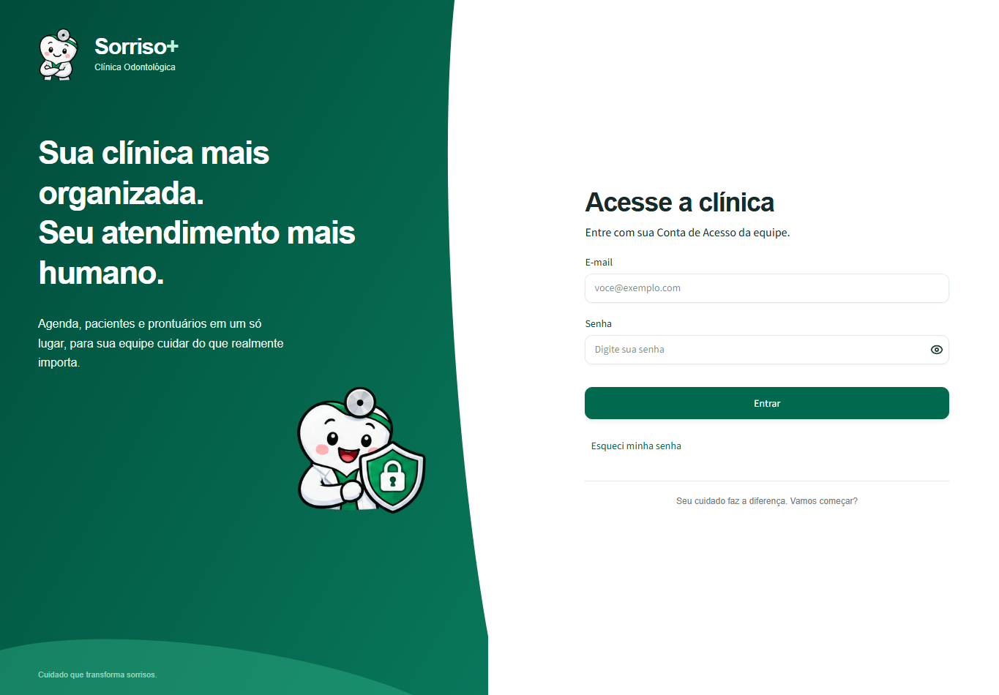
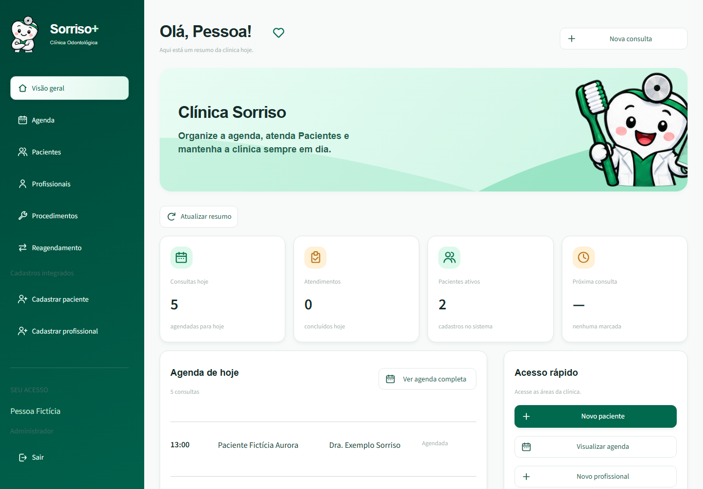
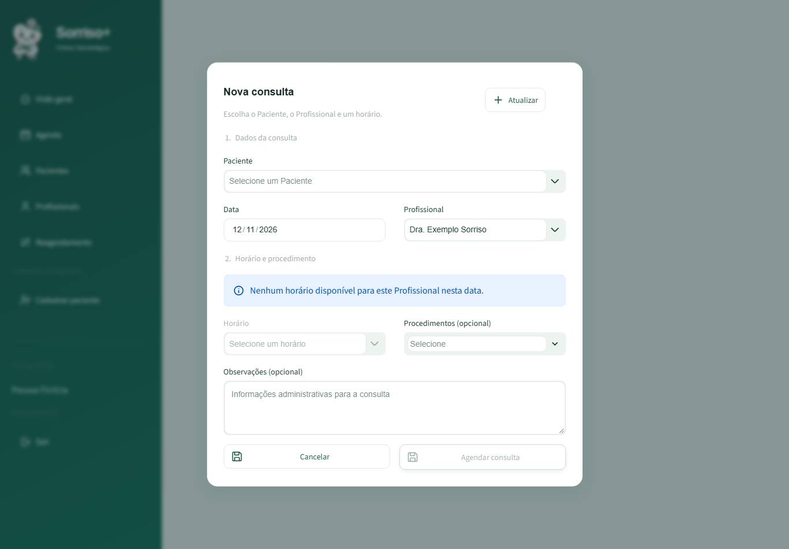
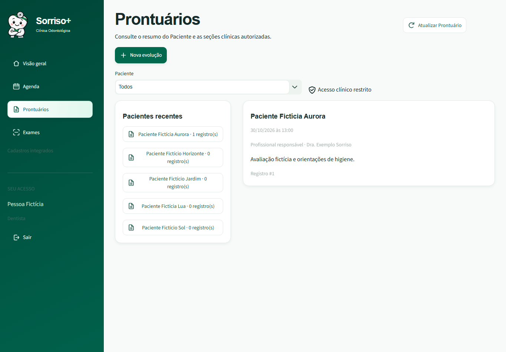
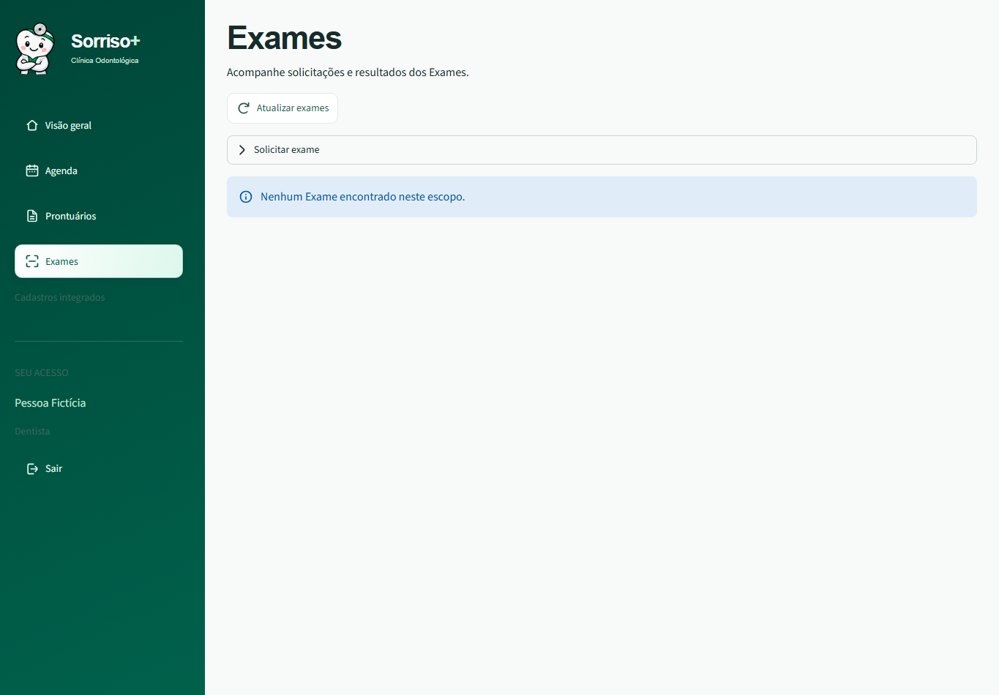

# Sorriso+ | Manual de uso

## 1. Apresentação

O **Sorriso+**, desenvolvido no projeto Odonty, é um aplicativo web acadêmico para organizar o atendimento em uma clínica odontológica. Ele reúne a Agenda, os cadastros e o histórico do atendimento para facilitar a consulta de informações e evitar conflitos de horário.

O aplicativo acompanha o trabalho de Administradores, Recepcionistas e Dentistas.

## 2. Acesso ao aplicativo

O código está no [repositório público Odonty](https://github.com/Viana-vv/Odonty). A versão web pode ser executada localmente. Até a revisão deste manual, o projeto não divulgava um endereço público de implantação do aplicativo.

- **Equipe** — abra [localhost:8501](http://localhost:8501) e entre com a Conta de Acesso de Administrador, Recepcionista ou Dentista.
- Para a demonstração, solicite ao grupo contas fictícias ativas para os perfis que serão usados. Use **Esqueci minha senha** na entrada da equipe para solicitar um código por e-mail quando o serviço de recuperação estiver configurado.



<details>
<summary>Como executar no seu computador</summary>

Instale o Git e o Python 3.10 ou superior. Os comandos abaixo usam o grupo de API Xano do projeto. Execute os comandos na raiz da cópia do repositório.

**Windows (PowerShell)**

```powershell
git clone https://github.com/Viana-vv/Odonty.git
cd Odonty
py -3 -m venv .venv-local
.\.venv-local\Scripts\python.exe -m pip install -r requirements.txt
$env:XANO_API_BASE_URL = "https://x8ki-letl-twmt.n7.xano.io/api:sorriso-acesso:v1"
.\.venv-local\Scripts\python.exe -m streamlit run app.py --server.port=8501
```

**macOS ou Linux (Terminal)**

```bash
git clone https://github.com/Viana-vv/Odonty.git
cd Odonty
python3 -m venv .venv-local
.venv-local/bin/python -m pip install -r requirements.txt
export XANO_API_BASE_URL="https://x8ki-letl-twmt.n7.xano.io/api:sorriso-acesso:v1"
.venv-local/bin/python -m streamlit run app.py --server.port=8501
```

</details>

## 3. Perfis de usuários

| Perfil | Responsabilidades e permissões |
| --- | --- |
| **Administrador** | Gerencia cadastros de Pacientes e Profissionais, cria Contas de Acesso de Recepcionista, organiza a Agenda e gerencia o catálogo de Procedimentos. O conteúdo clínico fica restrito aos perfis autorizados. |
| **Recepcionista** | Cadastra e atualiza Pacientes, consulta Profissionais, agenda e reagenda Consultas, gerencia Procedimentos e acompanha a fila operacional de Exames. A fila mostra dados do pedido e a situação, com o conteúdo clínico restrito aos perfis autorizados. |
| **Dentista (Profissional)** | Organiza seus horários, acompanha os atendimentos sob sua responsabilidade, registra Procedimentos da Consulta e evoluções clínicas, e solicita e atualiza Exames no seu escopo. Pode criar Procedimentos no catálogo. |

## 4. Funcionalidades

- **Agenda e Consultas** — disponibilidades por Profissional, agendamento, confirmação, reagendamento, cancelamento e acompanhamento da situação do atendimento.
- **Cadastros** — Pacientes, Profissionais e Contas de Acesso de Recepcionista, conforme as permissões.
- **Procedimentos** — pesquisa, criação e gestão do catálogo, associação à Consulta e registro de realização quando habilitado.
- **Prontuários** — consulta ao histórico autorizado e registro de evoluções clínicas.
- **Exames** — solicitação, atualização de situação e acompanhamento operacional.

## 5. Manual de utilização

As capturas mostram o aplicativo com dados fictícios e respostas simuladas. Use-as para localizar os controles.

### Administrador — preparar a equipe e os cadastros

1. Entre na aplicação da equipe e abra **Visão geral**.
2. No menu lateral, em **Cadastros integrados**, escolha **Cadastrar profissional**. Preencha os campos solicitados, incluindo o CRO e a Especialidade, e confirme. Confira o cadastro em **Profissionais**.
3. Selecione **Cadastrar recepcionista**. Informe nome, e-mail, senha inicial e confirmação. Depois da mensagem de sucesso, a Recepcionista pode entrar pela tela da equipe com a Conta de Acesso criada.

<details>
<summary>Ver o painel do Administrador</summary>



</details>

### Recepcionista — cadastrar o Paciente e agendar a Consulta

1. Entre pela tela da equipe. Abra **Pacientes → Cadastrar paciente**, preencha os campos solicitados com dados fictícios e salve. Confira se o Paciente aparece na listagem.
2. Abra **Agenda → Nova consulta**. Selecione o Paciente, a data e o Profissional. Escolha um horário disponível. Se for pertinente, selecione os Procedimentos e preencha as observações administrativas.
3. Clique em **Agendar consulta**. O agendamento confirmado pelo sistema aparece na Agenda, vinculado ao Paciente e ao Profissional. Se o horário tiver sido ocupado, atualize a Agenda e selecione outro.
4. Quando o horário precisar mudar, abra **Reagendamento**, selecione a Consulta e um horário disponível, informe a justificativa e clique em **Reagendar consulta**. Confira o novo horário na Agenda.



### Dentista — atender e registrar a evolução

1. Entre pela tela da equipe. Em **Agenda**, selecione a data e localize a Consulta. Para abrir disponibilidade, use **Novo horário**, defina o intervalo e salve.
2. Abra a Consulta e atualize sua situação conforme o atendimento. Em **Procedimentos da Consulta**, confira os itens vinculados e registre a realização quando a ação estiver disponível.
3. Abra **Prontuários → Nova evolução**. Selecione o Paciente e, para identificar o atendimento, escolha a Consulta relacionada. Digite a evolução e clique em **Salvar no prontuário**. Após a confirmação, confira o histórico em **Evolução Clínica**.
4. Para solicitar um Exame, abra **Exames → Solicitar exame**, selecione o Paciente e a Consulta e preencha o tipo, a data e as observações pertinentes. Clique em **Solicitar exame** e confira a situação **Solicitado** na lista.

<details>
<summary>Ver as telas de Prontuários e Exames</summary>





</details>

## 6. Exemplo de utilização

Use a **Paciente Demonstração**, a **Dra. Marina Exemplo** e o Procedimento **Avaliação inicial**. Prepare um horário livre para agendar e uma Consulta anterior para demonstrar a evolução e o histórico.

| Etapa | Ação | Resultado esperado |
| --- | --- | --- |
| Preparação | O Administrador verifica os cadastros da equipe e o Dentista oferece um horário. | O horário fica disponível para o agendamento. |
| Agendamento | A Recepcionista agenda a Avaliação inicial para a Paciente Demonstração. | A Consulta aparece na Agenda da equipe. |
| Atendimento | O Dentista abre a Consulta anterior e salva a anotação fictícia “Orientações de higiene registradas no atendimento de demonstração”. | A evolução fica vinculada ao Prontuário e à Consulta do exemplo. |
| Acompanhamento | O Dentista solicita um Exame para a Consulta anterior. | O pedido aparece na lista de Exames com a situação **Solicitado**. |

### Roteiro do vídeo de funcionamento

| Tempo | O que mostrar no aplicativo web |
| --- | --- |
| **00:00–00:30** | Apresente o problema de organizar horários e centralizar o histórico. Identifique os três perfis da equipe. |
| **00:30–01:00** | **Administrador.** Mostre o painel e a preparação dos cadastros necessários. |
| **01:00–02:15** | **Recepcionista.** Selecione a Paciente de exemplo, faça o agendamento e mostre a Consulta na Agenda. |
| **02:15–04:00** | **Dentista.** Abra a Consulta anterior do exemplo, salve uma evolução, confira o histórico e mostre o registro de um Exame. |
| **04:00–05:00** | Mostre um reagendamento ou o filtro de Procedimentos. Confira o resultado da operação na tela. |

Grave com o aplicativo web aberto. Prepare as contas e os dados fictícios antes da gravação. Publique o vídeo no YouTube como **Não listado** e inclua o link no arquivo de entrega.

## 7. Limitações conhecidas

- O Sorriso+ é um MVP acadêmico para demonstração com dados fictícios.
- O Prontuário completo segue em desenvolvimento. A Evolução Clínica tem fluxo próprio. O preenchimento de todas as seções estruturadas, o odontograma gráfico e o acesso a documentos clínicos ainda têm pendências. Se o carregamento do Prontuário completo estiver indisponível, a tela pode exibir seções vazias mesmo com o histórico de evoluções disponível. [Pendências do Prontuário](openspec/changes/implementar-prontuario-completo/tasks.md)
- Solicitações de Exame ficam no aplicativo. O envio automático para laboratórios está fora do fluxo atual.
- Pagamentos, convênios, estoque, integração com WhatsApp e suporte a múltiplas clínicas estão fora do escopo desta versão. [Escopo do projeto](docs/project-overview.md)

Para instalação avançada, testes e integração com o Xano, consulte o [guia técnico](docs/guia-tecnico.md).
